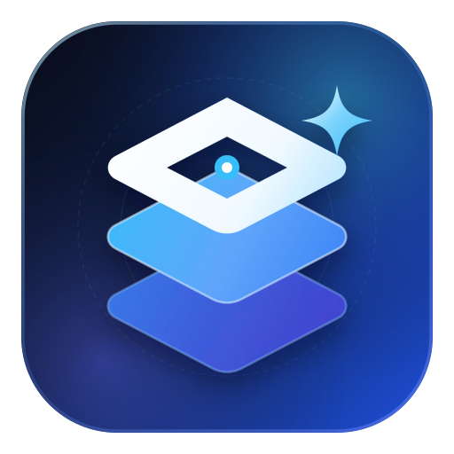

<div align="center">



# Alex (ProtoFlow AI)

### Turn Requirements into Runnable Business Prototypes

Describe your business workflow — Alex clarifies edge cases first, plans your sitemap, pages, and shared relational tables,<br/>
lets you refine **Desktop Admin** & **Mobile Viewports** on a bidirectional AST canvas, and publishes interactive review links in one click.

[](./LICENSE)
[](https://github.com/EvanClub-Agent/protoflow-ai/actions)
[](https://github.com/EvanClub-Agent/protoflow-ai/releases)
[](./deploy/compose.yml)
[](./.nvmrc)
[](./server/go.mod)

[简体中文](./README.md) · **English**

[Quick Start](#-quick-start-in-60-seconds) · [Why Alex](#-why-alex) · [Key Features](#-key-features) · [Self-Host with Docker](#-self-hosted-deployment-docker-compose) · [Contributing](#-contributing)

<br/>


</div>

---

## 💡 Why Alex?

Product managers and engineering teams are often stuck between **static wireframing tools** (where forms don't submit and tables don't share data) and **one-shot AI HTML generators** (that guess requirements blindly, invent isolated mock data per page, and break layouts on follow-up edits).

**Alex (ProtoFlow AI)** bridges requirement engineering, relational data modeling, and interactive prototyping in one local-first desktop workbench:

- **Shared Physical Tables (ER) Across Pages**: Forms, tables, drawers, and ECharts bind to real project schemas — records created on an order form immediately flow into approval queues and mobile views.
- **Clarify First, Generate Second**: Powered by **NousResearch Hermes Agent**, Project AI asks clarifying questions on ambiguous business rules and proposes a structured blueprint before generating pages.
- **Bidirectional AST Canvas**: Drag-and-drop enterprise desktop & mobile materials or edit properties visually — synced losslessly with clean TSX DSL.
- **Desktop + Mobile in One Project**: Author wide-screen admin dashboards alongside iPhone mobile viewports sharing the exact same database tables.
- **100% Local-First & Offline Ready**: Works out of the box **without mandatory sign-in**. Projects stay on your disk (`.pflow` binary archive + Git-friendly unpacked tree), with optional **1-command Docker Compose** self-hosting for online `/p/{id}` team review links.

---

## ✨ Key Features

- **01 · Project-Level AI Planning**: Clarifies business constraints, proposes sitemaps + ER schemas, and supports scoped incremental edits without overwriting existing pages.
- **02 · Enterprise Desktop & Mobile Materials**: Built-in Ant Design-style query forms, master-detail tables, modals/drawers, composite blocks, mobile bottom sheets, and sandboxed freeform components.
- **03 · Navicat-Style ER Database Designer**: Visual relational schema editor, foreign-key validation, cross-module data transfer, and realistic preview datasets.
- **04 · 12 Native Apache ECharts + Mermaid Diagrams**: Bar, Line, Area, Pie, Donut, Scatter, Radar, Gauge, Funnel, Heatmap, Treemap, and Sankey charts bound directly to project tables, plus Mermaid architecture/sequence templates.
- **05 · Component Sticky Specs & Closed-Loop Audit**: Pin requirement notes directly onto UI controls, trace schema change impact across menus, and audit broken links or unbound foreign keys.
- **06 · Self-Hosted Online Sharing & Release Center**: Share password-protected, expiring, versioned `/p/{id}` interactive prototypes via a lightweight Go + PostgreSQL + Nginx stack.

---

## 🚀 Quick Start in 60 Seconds

No Go or PostgreSQL installation is required to run or develop the workbench locally — just **Node.js 22+**:

```bash
git clone https://github.com/EvanClub-Agent/protoflow-ai.git
cd protoflow-ai
npm install

# Start browser live-reload workbench (instant access, no login required)
npm run dev

# Or launch the full Electron desktop app (local autosave + Hermes AI Manager)
npm run electron:start
```

Choose from built-in starter templates right from the Welcome Launcher:
- **SaaS E-Commerce & Inventory Admin** (multi-page shared tables, PO-to-inbound transfer, sticky specs)
- **CRM Sales Analytics Dashboard** (table-bound ECharts line/bar charts + customer pipeline CRUD)
- **Modern Mobile & Hybrid App Starter** (mobile waterfall feed, task approval sheet, and cross-platform table sharing)

---

## 🐳 Self-Hosted Deployment (Docker Compose)

Want to share interactive `/p/{id}` prototype links with your team in the browser? Spin up the self-hosted publishing server (`PostgreSQL 18 + Go API + Nginx Viewer`) in 3 commands:

```bash
# 1. Copy environment config and set POSTGRES_PASSWORD & PUBLIC_ORIGIN
cp deploy/.env.example deploy/.env

# 2. Pull prebuilt GHCR images and start PostgreSQL, Go API, and Web Viewer (add --build if building locally)
docker compose --env-file deploy/.env -f deploy/compose.yml up -d

# 3. Verify service health
curl -fsS http://127.0.0.1:8088/healthz
```

Then click **"Local Mode · Connect Server"** in the Alex toolbar, enter your `PUBLIC_ORIGIN` (e.g. `http://localhost:8088` or `https://protoflow.example.com`), register an account, and publish!

Optional platform admin initialization for `/releases/admin`:

```bash
docker compose --env-file deploy/.env -f deploy/compose.yml exec api /app/protoflow create-admin admin
```

---

## 🤝 Contributing

We welcome PRs of all sizes! Because the canvas, material registry, and backend are cleanly decoupled, you can add a new UI component material, starter template, or Mermaid diagram in **15–30 minutes** using only `npm run dev` and `npm test`.

See **[CONTRIBUTING.md](./CONTRIBUTING.md)** for exact file paths and verification commands.

---

## 📄 License

Licensed under the **[Apache License 2.0](./LICENSE)**.  
Provider brand icons are courtesy of LobeHub Icons ([License Notice](./website/assets/providers/LICENSE)).
