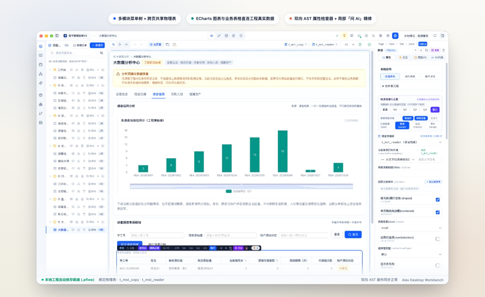

<div align="center">


# ProtoFlow AI

### Open-Source AI Prototyping Workbench — Turn Requirements into Runnable Apps

Describe your business workflow — ProtoFlow AI clarifies edge cases first, plans your sitemap, pages, and shared relational ER tables,<br/>
lets you refine **Desktop Admin** & **Mobile Viewports** with **UI Stack 5-State Simulation** & **Poka-Yoke Guardrails**, imports **Axure `.rp` & Figma `.fig`**, and connects coding agents via MCP.

**[Try Live Browser Demo](https://alex.xclubai.com/demo/)** · **[Official Website](https://alex.xclubai.com/en/)** · **[MCP Docs](https://alex.xclubai.com/mcp/)** · **[Join Discord](https://discord.gg/YDnKBhmsrR)** (share prototypes in `#general` or ask in `#help-and-bugs`).

[](https://alex.xclubai.com/en/)
[](./LICENSE)
[](https://github.com/EvanClub-Agent/protoflow-ai/actions)
[](https://github.com/EvanClub-Agent/protoflow-ai/releases)
[](./deploy/compose.yml)
[](./.nvmrc)
[](./server/go.mod)

[简体中文](./README.md) · **English**

[Live Browser Demo](https://alex.xclubai.com/demo/) · [Quick Start](#-quick-start-in-60-seconds) · [Why ProtoFlow AI](#-why-protoflow-ai) · [Key Features](#-key-features) · [Self-Host with Docker](#-self-hosted-deployment-docker-compose) · [Contributing](#-contributing)

<br/>



</div>

---

## 💡 Why ProtoFlow AI?

Product managers and engineering teams are often stuck between **static wireframing tools** (where forms don't submit and tables don't share data) and **one-shot AI HTML generators** (that guess requirements blindly, invent isolated mock data per page, and break layouts on follow-up edits).

**ProtoFlow AI (formerly Alex)** bridges requirement engineering, relational data modeling, and interactive prototyping in one local-first desktop workbench:

- **Shared Physical Tables (ER) Across Pages**: Forms, tables, drawers, and ECharts bind to real project schemas — records created on an order form immediately flow into approval queues and mobile views.
- **Clarify First, Generate Second**: Powered by **NousResearch Hermes Agent**, Project AI asks clarifying questions on ambiguous business rules and proposes a structured blueprint before generating pages.
- **Bidirectional AST Canvas**: Drag-and-drop enterprise desktop & mobile materials or edit properties visually — synced losslessly with clean TSX DSL.
- **Desktop + Mobile in One Project**: Author wide-screen admin dashboards alongside iPhone mobile viewports sharing the exact same database tables.
- **100% Local-First & Offline Ready**: Works out of the box **without mandatory sign-in**. Projects stay on your disk (`.pflow` binary archive + Git-friendly unpacked tree), with optional **1-command Docker Compose** self-hosting for online `/p/{id}` team review links.

---

## ✨ Key Features

- **01 · Project-Level AI Planning**: Clarifies business constraints, proposes sitemaps + ER schemas, and supports scoped incremental edits without overwriting existing pages.
- **02 · 134+ High-Ceiling Desktop & Mobile Materials + Brand Theme Tokens**: Popup-free `Repeater` Master-Detail workbenches, SQL-ENUM-disambiguated `Kanban` / `MKanban` boards, `Calendar` / `MCalendar` schedules, `AiCopilotCard` / `MAiInsightCard`, Bento Sparkline KPIs, drawers, mobile bottom sheets, sandboxed freeform components, and 4 project-level `designTokens` presets (`classic_antd`, `modern_minimal`, `industrial_dense`, `collab_soft`).
- **03 · UI Stack 5-State Matrix (`normal` / `empty` / `loading` / `edge` / `error`)**: One-click top-bar switcher in both the Desktop Designer and Published Viewer (`/p/{id}`) to inspect empty CTAs, skeletons, stress-test long strings (strictly isolated from project writes), and page/banner/component error fallbacks.
- **04 · Navicat-Style ER Designer, Poka-Yoke Guardrails & 5s Atomic Undo**: Visual relational schema editor with cross-field `minField` / `maxField` caps, phone/email/tax-ID format validation, multi-level `ON DELETE RESTRICT / CASCADE / SET NULL` closure checks, exact-match high-risk `confirm(msg, '{{row.ticket_no}}')`, and `deleteRow('undo')` 5-second atomic rollback.
- **05 · 12 Native Apache ECharts + Mermaid Diagrams & Sticky Specs**: Bar, Line, Area, Pie, Donut, Scatter, Radar, Gauge, Funnel, Heatmap, Treemap, and Sankey charts bound directly to project tables, paired with component sticky-note rules, rich PRD notes, and closed-loop audits.
- **06 · Self-Hosted Online Sharing & Release Center**: Share password-protected, expiring, versioned `/p/{id}` interactive prototypes via multi-arch (`linux/amd64` + `linux/arm64`) GHCR Docker images (`Go 1.27 + PostgreSQL 18 + Nginx`).
- **07 · Bidirectional MCP Authoring, Visual Capture & Read-Only Spec Server**: Let **Codex**, **Google Antigravity**, **Claude Desktop**, **Claude Code**, or **Cursor** directly design and refine prototypes on the live Alex Desktop canvas (`--mode readwrite --desktop-bridge`) — modeling shared ER tables, seeding FK-valid rows, editing `<Page>` / `<MobilePage>` subtrees by `selectedPfId`, verifying rendered layouts via `protoflow_capture_preview` PNG screenshots, and supporting multi-step `Cmd/Ctrl+Z` undo, with one-click **Antigravity plugin** install and **Claude Desktop `.mcpb`** export. For engineering handoff, connect in read-only mode to any `/p/{id}` share URL over Streamable HTTP (zero local install) or local `.pflow` file. See the **[Official MCP Setup & Tools Guide](https://alex.xclubai.com/mcp/)**.
- **08 · Native Axure (`.rp`) & Dual-Channel Figma (`.fig` / API) Import**: Unpack Axure RP 9/11 `.rp` and Figma `.fig` archives 100% offline in a local Worker (or sync Figma frame links via OS Keychain-encrypted PAT), then optionally reshape imported frames into table-bound flow layouts alongside untouched originals.

---

## 🚀 Quick Start in 60 Seconds

Download desktop installers (new AppImages use `ProtoFlow_AI-*` and other installers retain the `Alex-*` filename) for macOS, Windows, and Linux from **[alex.xclubai.com/en/#download](https://alex.xclubai.com/en/#download)** or **[GitHub Releases](https://github.com/EvanClub-Agent/protoflow-ai/releases)**, try the **[StarLink Maintenance & Spare Parts Live Demo](https://alex.xclubai.com/demo/)** in your browser, or run from source locally (no Go or PostgreSQL installation is required — just **Node.js 22+**):

```bash
git clone https://github.com/EvanClub-Agent/protoflow-ai.git
cd protoflow-ai
npm install

# Start browser live-reload workbench (instant access, no login required)
npm run dev

# Or launch the full Electron desktop app (local autosave + Hermes AI Manager)
npm run electron:start
```

Choose from built-in starter templates right from the Welcome Launcher:
- **SaaS E-Commerce & Inventory Admin** (multi-page shared tables, PO-to-inbound transfer, sticky specs)
- **CRM Sales Analytics Dashboard** (table-bound ECharts line/bar charts + customer pipeline CRUD)
- **Modern Mobile & Hybrid App Starter** (mobile waterfall feed, task approval sheet, and cross-platform table sharing)

---

## 🐳 Self-Hosted Deployment (Docker Compose · Multi-Arch GHCR Images)

Want to share interactive `/p/{id}` prototype links with your team in the browser? Every release publishes multi-arch (`linux/amd64` + `linux/arm64`) images to GitHub Container Registry:

- **API Server**: `ghcr.io/evanclub-agent/protoflow-ai-api:latest` (or pin `:v0.1.1`)
- **Web Viewer & Release Center**: `ghcr.io/evanclub-agent/protoflow-ai-web:latest` (or pin `:v0.1.1`)
- **Database**: `postgres:18-alpine` (migrations run automatically on startup)

```bash
# 1. Copy environment config and set POSTGRES_PASSWORD & PUBLIC_ORIGIN
cp deploy/.env.example deploy/.env

# 2. Pull prebuilt GHCR images and start PostgreSQL, Go API, and Web Viewer (add --build if building locally)
docker compose --env-file deploy/.env -f deploy/compose.yml up -d

# 3. Verify service health
curl -fsS http://127.0.0.1:8088/healthz
```

**Rolling upgrade for existing deployments** (preserves PostgreSQL volumes):

```bash
docker compose --env-file deploy/.env -f deploy/compose.yml pull &&
  docker compose --env-file deploy/.env -f deploy/compose.yml up -d
```

> To pin a specific release in production, set `PROTOFLOW_API_IMAGE=ghcr.io/evanclub-agent/protoflow-ai-api:v0.1.1` and `PROTOFLOW_WEB_IMAGE=ghcr.io/evanclub-agent/protoflow-ai-web:v0.1.1` in `deploy/.env`.

Then click **"Local Mode · Connect Server"** in the Alex toolbar, enter your `PUBLIC_ORIGIN` (e.g. `http://localhost:8088` or `https://protoflow.example.com`), register an account, and publish!

Optional platform admin initialization for `/releases/admin`:

```bash
docker compose --env-file deploy/.env -f deploy/compose.yml exec api /app/protoflow create-admin admin
```

---

## 🤝 Contributing

We welcome PRs of all sizes! Because the canvas, material registry, and backend are cleanly decoupled, you can add a new UI component material, starter template, or Mermaid diagram in **15–30 minutes** using only `npm run dev` and `npm test`.

See **[CONTRIBUTING.md](./CONTRIBUTING.md)** for exact file paths and verification commands.

---

## 📄 License

Licensed under the **[Apache License 2.0](./LICENSE)**.  
Provider brand icons are courtesy of LobeHub Icons ([License Notice](./website/assets/providers/LICENSE)).
